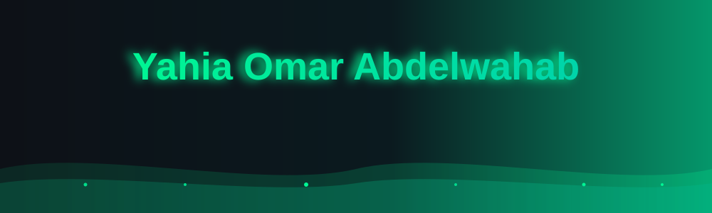

<h3><code>Flutter Engineer | Applied AI Developer | 3+ years</code></h3>

 

## 👋 About me

I'm a software engineer who builds cross-platform mobile apps with **Flutter** and **Clean Architecture**, and I'm now taking that into **Applied AI**: RAG assistants, AI agents and LLM-powered products.

- 📱 3+ years of Flutter: MVVM, Clean Architecture, BLoC/Cubit, Firebase, CI/CD with GitHub Actions and Fastlane
- 🤖 Building with LLMs: RAG customer-service agents, AI video avatars, embeddings and Redis semantic caching, tool-calling agents on the Claude API and MCP
- 📦 Author of [`flutter_clean_structure`](https://pub.dev/packages/flutter_clean_structure), a CLI that scaffolds a full Clean Architecture Flutter project in one command
- 🎓 B.Sc. in Communication and Electronics Engineering, Mansoura University
- 🏅 4 Anthropic certifications: Claude Code, Agent Skills, the Claude API and MCP

 

## ⌨️ Tech stack

  

 

## 🚀 Featured work

<table>
  <tr>
    <td width="50%" valign="top">
      <h4>📦 flutter_clean_structure</h4>
      A published Dart CLI that generates 20+ ready-to-code files: DI with get_it, Dio + Retrofit networking, Freezed models, Cubits and routing. Safe to re-run, since it never overwrites your files.
        
      <a href="https://pub.dev/packages/flutter_clean_structure">pub.dev</a> · <a href="https://github.com/yahiaomarab/flutter_clean_structure">GitHub</a>
    </td>
    <td width="50%" valign="top">
      <h4>🧑‍💼 AI video avatar agent for NWC</h4>
      A demo AI avatar built end to end, from architecture to a live deployment.
        
      <a href="https://agentsystem-production-a1f9.up.railway.app/?project=bader-nwc-ksa&public=true">Live demo</a>
    </td>
  </tr>
  <tr>
    <td width="50%" valign="top">
      <h4>💬 HoloBox agent with RAG</h4>
      A RAG-powered customer-service agent linked to a website UI, answering customer questions.
    </td>
    <td width="50%" valign="top">
      <h4>🍔 Foodian</h4>
      A food delivery app built across the full stack: a Flutter frontend with a FastAPI backend (JWT auth, SQLAlchemy, restaurants, cart and orders).
    </td>
  </tr>
</table>

 

## 📊 GitHub stats

  
  

 

